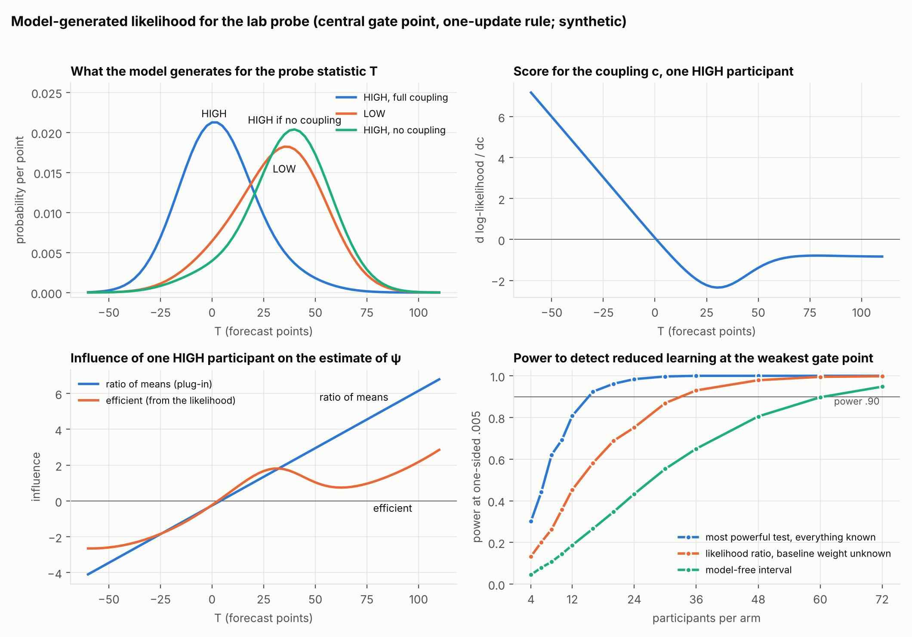

# The model in symbols, a minimal scenario, and the likelihood at the frontier (KGi-DISS-I039, 2026-11-11)

Everything in this record is synthetic. There are no human data.

- **Freeze.** `freezes/00_freeze_I039.yaml` was pushed before any computation.
  Addenda AD-L2 and AD-F2 were committed before their own runs.
- **Formal part.** `formal_diss/DissAggregation.lean` on CSL branch
  `lean-diss-core` (11f09cb). Lean 4.28.0, core only, over the rationals.
  Twelve theorems, each with axioms `[propext, Classical.choice, Quot.sound]`
  and nothing else.
- **Scorecards.** Verbatim in the freeze. Most of my numerical predictions
  failed; they are listed at the end.

## Correction to I038

I038 tested whether the trap depends on the distribution of individual
discounting only through its mean. The frozen test failed (trap probability
differs by up to .38 at equal means). I then re-stated the claim as an edge
location and used it to justify a mean-type estimand.

That was the wrong way round. The failed test was the result. The programme's
own aggregation finding says the aggregate is not a function of the mean. The
sufficiency reading is withdrawn. `ψ` stays as what it is: the first moment of
the relative gain distribution.

## S. The model in symbols

**State.** Agent `i` holds a belief `q`, a legitimacy `l ∈ [0,1]` and an
aspiration `a ∈ [0,1]`. Evidence `e` produces the error `δ = e − q`.

**Kernel** (as coded in the task generator; `φ⁻ = 1`):

```
gain          γ_c(l) = 1 − c·(1 − l)                       paper: c = 1, γ = l
K1  belief    q' = q + κ·γ_c(l)·δ
K2  legit.    D  = max(a − r, 0) + φ⁺·max(r − a, 0)
              l' = clip01( l − ν_F·max(D − τ, 0) + ν_R·[D ≤ τ] )
K3  aspir.    a' = clip01( (1 − ρ)·a + ρ·((1 − χ)·r + χ·ref) )
```

**Implications.** "Lean" means machine-checked over the rationals, two types
where a population is involved.

| | statement | authority |
|---|---|---|
| P1 freeze | `c = 1 ∧ l = 0 ⟹ ∀δ: q' = q` | Lean T6 |
| P2 gain ratio | `γ_c(1) = 1`, `γ_c(0) = 1 − c`, so `c = 1 − γ_c(0)/γ_c(1)` | Lean T7 |
| P3 reference | same outcomes `r_t ∈ {0,1}`, `φ⁺ ≤ τ`: `∀t ref_t ≤ ref'_t ⟹ ∀t (a_t ≤ a'_t ∧ l_t ≥ l'_t)` | Lean T13 |
| P4 aggregation | `mean(Δq) = κ·( mean(γ)·mean(δ) + Cov(γ, δ) )` | Lean T8 |
| P5 dispersion | second step: `mean(w(1 − w)) = m(1 − m) − Var(w)` | Lean T9, T10 |
| P6 horizon | residual error after `t` events: `mean((1 − w)^t) ≥ (1 − mean(w))^t`, every `t` | Lean T11; Jensen in general |
| P6b not mean-sufficient | `¬∃f ∀G ∀t: residual_t(G) = f(mean_G(w), t)`; witness at `t = 2` | Lean T9c (strict) |
| P7 limit | `residual_t(G) → G({w = 0})`; the mean-gain agent `→ 0` | analytic |
| P8 two types | `ψ = 1 − cπ`, `V = c²π(1 − π)` `⟹` `c(1 − ψ) = V + (1 − ψ)²` | Lean T12 |
| P9 product bound | `ψ ≥ 1 − c` under a linear rule | Lean T14 |
| association | two quantities ordered alike across types have covariance `≥ 0` | Lean T15 |

Three things the formal work added:

- **A scope condition.** P3 needs `φ⁺ ≤ τ`. Without it, a win far above a low
  aspiration creates dissonance and the order reverses (explicit
  counterexample in the audit file). The frozen values satisfy it (.25 ≤ .3).
- **Fidelity.** The Lean kernel, evaluated on a six-trial history under both
  boards, equals a Python transcription of the generator's update lines as
  exact rationals.
- **P6b is the aggregating-inertia statement.** The mean gain determines the
  aggregate response for one step and no further.

**What P6 means in numbers.** Take the model's own HIGH population at probe
time and feed it `t` pieces of evidence. Residual error, population against a
representative agent with the mean gain:

| gate point | share with `l = 0` | t = 2 | t = 10 | t = 20 | t = 50 | limit |
|---|---|---|---|---|---|---|
| P1 paper's values | .39 | .91 / .89 | .83 / .57 | .79 / .32 | .70 / .06 | .39 / 0 |
| P2 | .30 | .89 / .87 | .77 / .49 | .70 / .24 | .59 / .03 | .30 / 0 |
| P4 anchoring edge | .17 | .68 / .63 | .47 / .10 | .41 / .01 | .34 / .00 | .17 / 0 |

After 20 events the population still holds 79% of its error where the mean
agent would hold 32%.

## M. The minimal scenario

**Σ = what design S1x already records per participant: arm, the last fairness
rating `F`, and the probe statistic `T`.** Nothing is added to the task.

- P1–P3 need two arms and one gain measure. That is `T`.
- P4–P6b need a second coordinate that tracks the gate state person by
  person. That is `F`.

| observable implication | statement |
|---|---|
| O1 first moment | `ψ = E[T \| HIGH] / E[T \| LOW] < 1` |
| O2 state dependence | `Cov(T, F \| arm) > 0` wherever legitimacy varies and `c > 0` |
| O3 freeze | at `c = 1`, participants at the bottom of the fairness scale do not revise |

O2 is the negative of mean sufficiency in observable form. Given `l`, `T` and
`F` are independent and both increase in `l`, so
`Cov(T, F) = Cov(E[T|l], E[F|l]) ≥ 0`.

| rival | ψ | T–F association |
|---|---|---|
| R3 (ratings move, gain does not) | 1 | none |
| HS (everyone in HIGH slowed by one factor; the Ham–Jenkins class) | < 1 | none |
| SH (a trait moves rating and weight in both arms) | 1 | both arms |
| gate | < 1 | both arms |

## L. The likelihood

**Generator.** ABM agents perform the ten-repetition task with the gate
kernel. Their legitimacy at probe time gives the empirical distribution
`G_arm` (100,000 agents per arm and gate point).

**Kernels.**

- `k(t | w)`: the distribution of `T` for a participant with revision weight
  `w`. Computed exactly, without Monte Carlo: discretised normal reports,
  cross-correlated into a revision, integrated over the prior, convolved over
  the four tickets. Against the simulator: total variation .0024–.0026.
- `h(f | l)`: the rating, rounded and clipped, with mean `50 + a(100l − 50)`.

**Likelihood of one participant.**

```
p(t | arm; θ)    = q·k(t | 0) + (1 − q)·Σ_l G_arm(l)·k(t | w(l; c))
p(f, t | arm; θ) = Σ_l G_arm(l)·h(f | l)·[ q·k(t | 0) + (1 − q)·k(t | w(l; c)) ]

w(l; c) = κ·γ_c(l)                 one-update rule
w(l; c) = 1 − (1 − α·γ_c(l))^m     count rule
```

`θ` holds the coupling `c` and the nuisances: baseline weight (`κ` or `α`),
forecast noise, inattention `q`, rating gain `a`, rating noise, and the depth
of delegitimation.

**Score, information, influence functions.**

```
score                       s_j(x) = ∂ log p(x; θ) / ∂θ_j
information                 I = Σ_x p(x)·s(x)·s(x)ᵀ, summed over one participant per arm
efficient influence fn.     φ_eff = ∇ψᵀ·I⁻¹·s          bound on Var(ψ̂): ∇ψᵀ·I⁻¹·∇ψ / n
plug-in influence fn.       φ_np(arm, t) = 2·[ 1{H}(t − μ_H) − ψ·1{L}(t − μ_L) ] / μ_L
```

Check: `Cov(φ_np, φ_eff) = Var(φ_eff)` (.6980 = .6980 at P1, one-update
rule), as it must be for a regular estimator.



The efficient influence function is linear in the bulk of `T` and flattens
above about 40 points. Large revisions come mostly from recovered agents and
say less about `ψ`.

## F. Is the ratio a good idea?

**For ψ from T alone: yes, once the depth of delegitimation is not assumed
known.** Relative efficiency of the ratio of means (information bound over
its variance):

| what is assumed about the depth | P1 one-update | P1 count | P4 one-update | P4 count |
|---|---|---|---|---|
| gate point known exactly | .85 | .42 | .50 | .20 |
| unknown along both directions tested | 1.00 | .99 | 1.00 | .95 |
| with the rating `F` added, depth unknown | .78 | .68 | .51 | .59 |

- Knowing the gate point exactly is assuming what the experiment is meant to
  learn. Without it the ratio of means is at the bound.
- With the rating as a covariate the bound drops by a further 22–49%. An
  estimator of `ψ` that adjusts for `F` could save that many participants, if
  the rating link is trusted. It is not designed here.

**For the coupling c: T alone does not identify it; the ratings do.** Take
the hardest direction: every HIGH legitimacy a little higher. For a collapsed
agent this moves the gain exactly as a lower coupling does.

| share of the information for `c` kept when that shift is unknown | P1 | P4 |
|---|---|---|
| `T` alone (one-update \| count) | 7% \| 1% | 27% \| 2% |
| `(F, T)`, rating gain also unknown | 91% \| 38% | 96% \| 61% |

Bound on the standard error of `c` at 72 per arm from `(F, T)`, nuisances
unknown: .06–.08 (one-update), .02 (count). Certifying `c ≥ .90` then needs
about 370–610 per arm under the one-update rule. Under the count rule it
needs 27–60 along my first depth direction and about 70–90 along the shift
(arithmetic on the information values in the record). These are asymptotic
bounds, not designs.

**Power at the frontier** (participants per arm for power .90 at one-sided
.005, test of no coupling against full coupling):

| | P1 one-update | P4 one-update | P1 count | P4 count |
|---|---|---|---|---|
| most powerful test, everything known | 8 | 16 | 4 | 12 |
| the same with `(F, T)` | 6 | 10 | 4 | 6 |
| likelihood ratio, baseline weight unknown, size controlled | 16 | 36 | | |
| model-free interval for `ψ` | 24 | 60–72 | 16 | 48 |

- The interval pays a factor of 1.5–2 against a valid likelihood test, and 3–4.5
  against the oracle.
- The likelihood route is fragile. With a fixed critical value the profiled
  test rejected a true null in up to 50% of samples when the baseline weight
  differed from its assumed value. The interval held its size (.004–.006).

**Coverage at the frontier** (profile-likelihood interval for `ψ`, gate point
known, 72 per arm, level .99):

| truth `c` | ψ | coverage | width relative to the Fieller interval |
|---|---|---|---|
| .5 | .59 | .991 | .84 |
| .75 | .37 | .995 | .82 |
| .9 | .23 | .991 | .66 |
| 1 | .13 | .996 | .36 (estimate on the boundary in 58% of samples) |

**State dependence (O2).** One-sided rank tests at 72 per arm.

| | P0 | P1 | P2 | P3 | P4 |
|---|---|---|---|---|---|
| association in HIGH only, one-update rule | .00 | .29 | .41 | .31 | 1.00 |
| pooled over both arms, one-update rule | .22 | .73 | .64 | .81 | 1.00 |
| pooled over both arms, count rule | .20 | .81 | .77 | .87 | 1.00 |

- Under the model the association is present in both arms (Spearman .22–.33
  in LOW). A HIGH-minus-LOW contrast therefore has no power (.00–.02 at the
  central points).
- **Conjunction** of `ψ < 1` and the pooled association: false positives .000
  (R3), .0035 (HS), .0018 (SH). This is the first test in the programme that
  rejects the homogeneous-slowdown rival.
- The rank test is far from the frontier. Independence against the model's
  joint distribution needs 36–72 per arm at the frontier; the HIGH-only rank
  test needs 200–300 at the central points.
- **The two estimands are complementary across the theory region.** At P0
  everyone has collapsed: `ψ` is extreme (.01) and there is no variation to
  show state dependence. At the anchoring edge `ψ` is weakest (.47–.51) and
  state dependence is strongest.

## Predictions that failed (kept)

1. The ratio of means reaches 60–95% of the bound with the gate point known:
   only at P1 under the one-update rule.
2. Ratings at least double the information for `c`: they add 13–95%.
3. `T` alone keeps at most 10% of the information when the depth is unknown:
   it keeps 43–95% along my first depth direction. The hard direction is the
   uniform shift (1–27%).
4. Frontier sample sizes at 35–60% of the interval's: they are 22–33%.
5. The profiled likelihood-ratio test within 1.3 times the oracle: 1.5 at P4,
   and it did not hold its size.
6. State-dependence power .50–.95 at the central points: .29–.41 (HIGH only),
   .64–.87 (pooled).
7. The HIGH-minus-LOW contrast 10–30 points below the HIGH-only test: it has
   no power at the central points.
8. Rank test within 40–70% of the frontier for dependence: 18–30% at the
   central points.
9. Several AD-L2 bands under the count rule.

## What this rests on

- The likelihood results assume the model family, including Gaussian report
  noise and the rating link. They are bounds on what could be learned, not
  designs.
- `G_arm` comes from the task simulated at full coupling, with the assumed
  rigidity mix and the effective-draws assumption (I037).
- Lean covers algebra and order only. Nothing stochastic is certified.
- A uniform slowdown combined with a trait that links rating and weight
  passes the conjunction test. Separating it needs the equality of the
  between-arm and within-arm slopes, corrected for rating noise.

## Next

1. A state-dependence statistic close to its frontier (a contrast between the
   collapsed stratum and the rest, instead of a rank correlation), and the
   slope-equality test against the composite rival.
2. A covariate-adjusted estimator of `ψ` using `F`, with its own robustness
   check.
3. The two-step probe implied by P5 (it measures the dispersion of gains
   without the ratings). Stated here, not evaluated.
